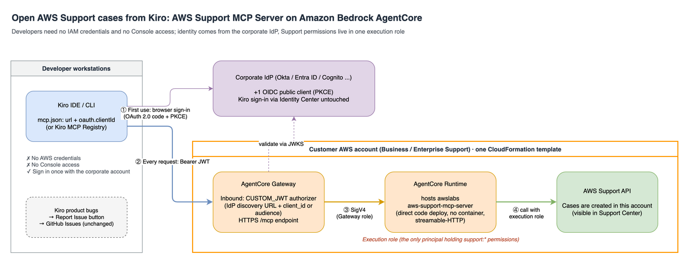

# AWS Support MCP Server on Amazon Bedrock AgentCore

**English** | [简体中文](README.zh-CN.md)

Open, monitor, and reply to AWS Support cases directly from [Kiro](https://kiro.dev) — **without giving developers IAM credentials or AWS Management Console access**.

Enterprise Support entitlements are account-level, but filing a case normally needs Console access or IAM credentials with `support:*` permissions, which most developers do not have. This sample hosts the open-source [AWS Support MCP Server](https://github.com/awslabs/mcp/tree/main/src/aws-support-mcp-server) on **Amazon Bedrock AgentCore Runtime**, exposes it through an **AgentCore Gateway** that validates tokens from your corporate identity provider (Okta, Microsoft Entra ID, ...) — or from **AWS IAM Identity Center** through an Amazon Cognito user pool the template creates — and keeps the Support API permissions in **one IAM execution role** owned by the platform team. One CloudFormation template deploys everything into your own AWS account.

## How it works

1. Kiro connects to the Gateway URL; on first use the developer signs in to the corporate IdP in the browser (OAuth 2.0 authorization code + PKCE, public client, no secret on developer machines).
2. Every MCP request carries the resulting JWT. The Gateway validates it (`CUSTOM_JWT` authorizer) and forwards the call to the Runtime with its own IAM role (SigV4).
3. The Runtime hosts the vendored `awslabs.aws-support-mcp-server` (one logging line changed, see [THIRD-PARTY-LICENSES](THIRD-PARTY-LICENSES)) behind a ~30-line streamable-HTTP entrypoint ([`app/main.py`](app/main.py)).
4. The Runtime **execution role** is the only principal with Support API permissions. Cases appear in Support Center like any other case.

Kiro sign-in itself is untouched, and Kiro product bugs still go through Kiro's built-in **Report Issue** channel. This sample is for cases that need your AWS Support plan.

## For IT / platform teams — deploy in four steps

| Step | What you do | Details |
|---|---|---|
| 1 | Pick an identity mode and set it up: an OIDC **public** client in your IdP (PKCE, no secret, redirect `http://localhost:<port>/oauth/callback`), **or** a SAML 2.0 application in IAM Identity Center (organization instance) federated through the template's Cognito user pool, **or** standalone Cognito users for a pilot | [Identity modes](docs/deployment-guide.md#choose-an-identity-mode) · [Step 1](docs/deployment-guide.md#step-1--set-up-the-identity-provider) |
| 2 | `./build.sh` — builds the Linux arm64 code package with `uv` (no Docker) | [Step 2](docs/deployment-guide.md#step-2--build-the-code-package) |
| 3 | `./deploy.sh` with your IdP discovery URL / client ID (uploads the package and creates the stack, ~2 min) | [Step 3](docs/deployment-guide.md#step-3--deploy-the-stack) |
| 4 | Hand the `KiroMcpJson` stack output to developers, or publish it through Kiro MCP Registry | [Step 4](docs/deployment-guide.md#step-4--distribute-the-kiro-configuration) |

Prerequisites (a Business, Enterprise On-Ramp or Enterprise Support plan, an AgentCore region, an identity administrator), what the template creates, the three identity modes, upgrading from v1.0, and day-2 operations are in the **[Deployment guide](docs/deployment-guide.md)**.

## For developers — use it from Kiro in three steps

1. Add the `aws-support` snippet from IT to `~/.kiro/settings/mcp.json` (or pick it from the Kiro MCP Registry).
2. In Kiro's **MCP Servers** panel click **Authenticate** once and sign in with your corporate account — 11 `aws-support___*` tools appear.
3. Ask Kiro in plain language: *"Open an AWS Support case: ... Request ID abc-123, severity system impaired, put me@example.com on CC"*, *"List my open cases"*, *"Reply on case 1234567890: ..."*.

Prompts, what to expect (contact method, case attribution), and known client-side pitfalls are in the **[Developer guide](docs/developer-guide.md)**.

## Repository layout

| Path | What it is |
|---|---|
| [`cfn/support-mcp-agentcore.yaml`](cfn/support-mcp-agentcore.yaml) | CloudFormation template: AgentCore Runtime + Gateway + Gateway target + 2 IAM roles (optional Cognito user pool, standalone or federated to IAM Identity Center) |
| [`app/main.py`](app/main.py) / [`app/awslabs/`](app/awslabs/) | Runtime entrypoint and the vendored upstream server (v0.1.23, Apache-2.0) |
| [`build.sh`](build.sh) / [`deploy.sh`](deploy.sh) | Build the code package; upload to S3 and create/update the stack |
| [`scripts/cognito-add-users.sh`](scripts/cognito-add-users.sh) | Cognito mode: create standalone users from a list of e-mail addresses |
| [`kiro/`](kiro/) | `mcp.json.example` and an optional steering file that standardizes how cases are filed |
| [`docs/`](docs/) | [Deployment guide](docs/deployment-guide.md) · [Developer guide](docs/developer-guide.md) · [Security](docs/security.md) · [中文文档](docs/zh-CN/) |

## Security at a glance

- The Gateway validates JWTs against your IdP before anything reaches the Runtime; the Runtime accepts only IAM-authenticated (SigV4) calls, and the only role the template grants `InvokeAgentRuntime` is the Gateway role.
- Support permissions exist only on the Runtime execution role, as an explicit list of 11 actions; developers hold no AWS credentials.
- All cases are created by that one role; the reporter's identity goes into the case body and CC. Details, hardening options and extensions: **[Security](docs/security.md)**.

## Changes

See [CHANGELOG.md](CHANGELOG.md).

## Disclaimer

This repository contains **sample code for demonstration purposes and is not production-ready as-is**. Before any production use, review and adapt it to your organization's security, identity, compliance and operational requirements (for example IdP hardening, access restrictions via claims, logging and monitoring, and change management for the execution role's permissions).

## Security issue notifications

See [CONTRIBUTING](CONTRIBUTING.md#security-issue-notifications) for information on reporting security issues.

## License

This library is licensed under the MIT-0 License. See the [LICENSE](LICENSE) file. The vendored AWS Support MCP Server is licensed under the Apache License 2.0 — see [THIRD-PARTY-LICENSES](THIRD-PARTY-LICENSES).
